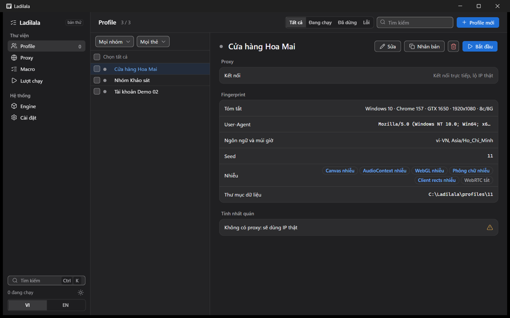
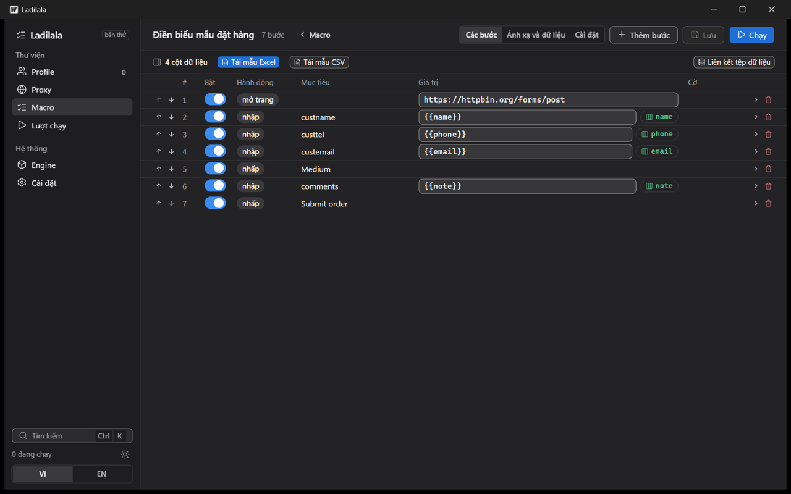
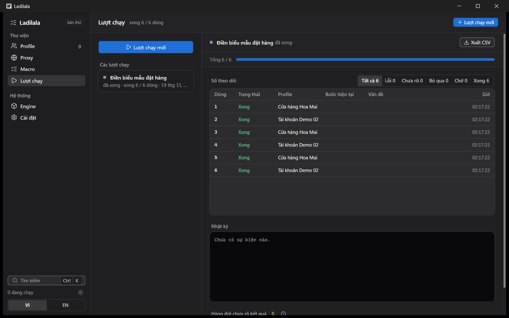
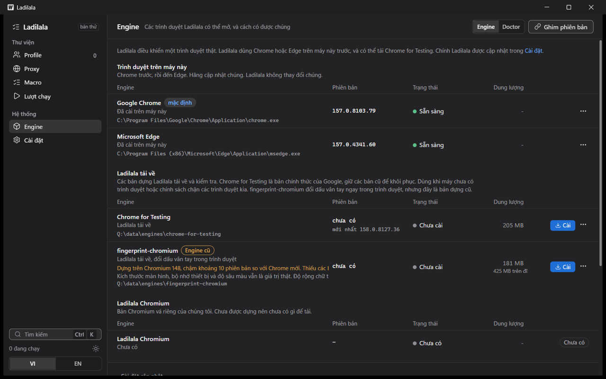

# Ladilala

[Tiếng Việt](README.md) | [English](README.en.md)

Ladilala là ứng dụng Windows làm hai việc.

- **Hồ sơ trình duyệt.** Mỗi hồ sơ là một trình duyệt riêng, có proxy riêng, danh tính riêng và đăng nhập riêng. Các hồ sơ không lẫn vào nhau.
- **Macro web.** Ghi một thao tác một lần trên trình duyệt. Ladilala lặp lại thao tác đó cho từng dòng dữ liệu Excel, CSV, JSON hoặc REST của bạn. Dùng để điền biểu mẫu.

Ứng dụng mặc định bằng tiếng Việt. Có sẵn tiếng Anh. Ứng dụng tự cập nhật.

## Hình ảnh

Danh sách hồ sơ trình duyệt.

Macro gồm các bước. Mỗi cột dữ liệu điền vào một ô của biểu mẫu.

Lượt chạy theo dõi từng dòng dữ liệu.

Engine là trình duyệt mà Ladilala mở.

## Tải về

Phiên bản 1.1.1, Windows 64-bit. Bấm nút ở trên, hoặc mở [bản phát hành mới nhất](https://github.com/71zone/ladilala/releases/latest).

- `ladilala-1.1.1-windows-amd64-setup.exe`: bộ cài đặt. Hãy dùng file này trước.
- `ladilala-1.1.1-windows-amd64.exe`: bản chạy trực tiếp. Không cần cài đặt.

Windows có thể hiện cảnh báo SmartScreen. Các file chưa được ký số. Hai trong 71 phần mềm diệt virus đánh dấu chương trình là có thể nguy hiểm. Cả hai cảnh báo đến từ luật học máy và nhiều khả năng là báo nhầm. Xem [kết quả VirusTotal của bản 1.1.0](https://www.virustotal.com/gui/file/4e8db0d2e8350dea35cef32c2eade86702f3b783d8e75904936236bb54c23164). Mã kiểm tra (checksum) nằm trong `SHA256SUMS.txt` của bản phát hành.

## Lưu ý

- Đã thử trên Windows 11. Chưa thử trên Windows 10.
- Chưa hỗ trợ Google Sheets.

## Dành cho lập trình viên

Xem [docs/development.md](docs/development.md) (tiếng Anh) để biết cấu trúc mã, cách build và cách chạy test.
